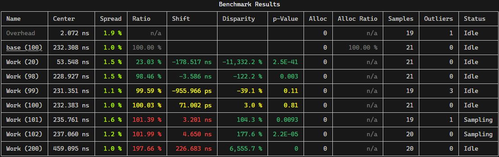

# AppleDust

> Apples to Apples, Dust to Dust

AppleDust is a comparative benchmarking tool for .NET/C# and rust.

It is mainly designed to proved **fast feedback** about performance differences caused by isolated code changes while being resilient against performance fluctuations caused by other processes on the machine.

Unlike most benchmarking tools, AppleDust samples it's targets *concurrently* instead of *sequentially*.
This provides better and faster feedback when comparing two or more targets that are expected to have very similar performance.

Example output:

## How-to

*TODO*
